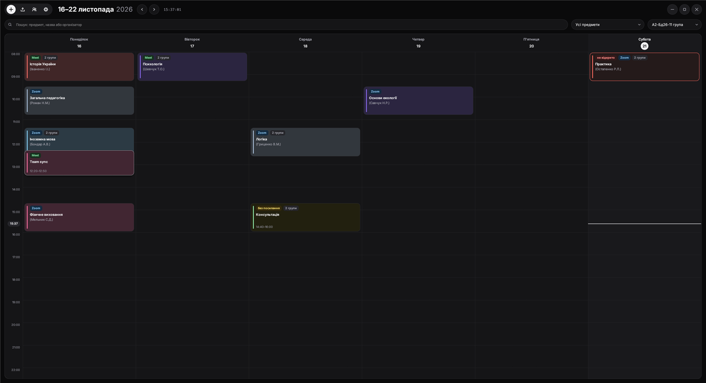
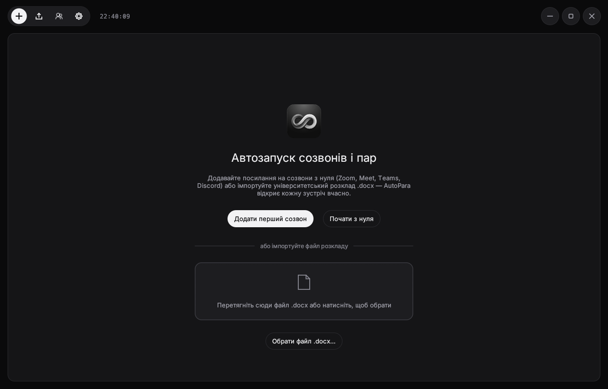
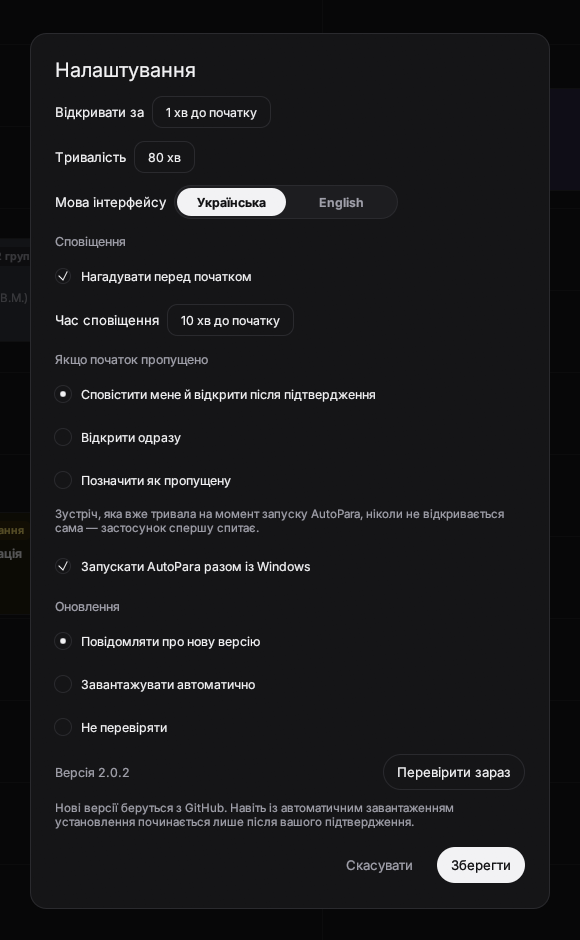
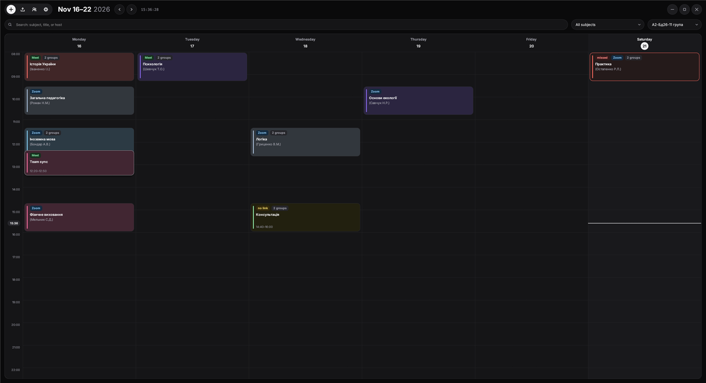

# AutoPara (Pure Rust)

100% pure Rust desktop app for auto-joining calls and university classes (Zoom, Google Meet, Microsoft Teams, Discord, Jitsi, Webex, Telegram, or any `http(s)://` link). Zero WebView, zero Electron, zero Python runtime, zero AI bloat.



| First launch | Settings |
| --- | --- |
|  |  |

The same week in English:



## Download

On the [Releases](https://github.com/reyjendiz/AutoPara/releases/latest) page:

- `AutoPara-<version>-Setup.exe`: Windows installer. Adds a desktop shortcut and starts AutoPara with Windows (both can be unticked). No admin rights needed.
- `AutoPara-<version>.dmg`: macOS, Apple Silicon.

## Features
- **Start from scratch or import `.docx`**: create personal meeting schedules from zero or import university `.docx` timetables.
- **Fire-once scheduler & reminders**: opens links automatically N minutes ahead, native OS notifications, catch-up banner for missed starts, system tray background mode.
- **GitHub Releases auto-updater**: checks for updates in the background (or manually in Settings), verifies size and SHA-256 over HTTPS (`github.com` / `githubusercontent.com` only), and installs only on user confirmation.
- **Cross-platform**: Windows (`x86_64`) and macOS Apple Silicon (`aarch64-apple-darwin`, M1/M2/M3/M4).
- **Languages**: Ukrainian (`Українська`) and English (`English`), dark-only interface.

## Build on Windows

```powershell
cargo test --workspace
cargo build --release -p autopara
# Output: target\release\autopara.exe
```

## Build on macOS (Apple Silicon M1/M2/M3/M4)

```bash
chmod +x scripts/build_macos_arm64.sh
./scripts/build_macos_arm64.sh
# Output:
#   dist/AutoPara.app
#   dist/AutoPara-<version>.dmg
```

To point the built-in auto-updater at your own GitHub repository, pass `AUTOPARA_GITHUB_REPO` at build time:

```bash
AUTOPARA_GITHUB_REPO="your-user/AutoPara" ./scripts/build_macos_arm64.sh
```

## GitHub Release (Automatic Windows + macOS ARM64 Builds)

Push a semver tag matching `version` in `crates/autopara-app/Cargo.toml`:

```bash
git tag v2.0.0
git push origin main --tags
```

GitHub Actions (`.github/workflows/release.yml`) automatically runs `clippy`, `cargo test`, builds `AutoPara-<version>-Setup.exe` and `AutoPara-<version>.dmg` (Apple Silicon), and publishes a GitHub Release that the in-app auto-updater detects immediately.
