# AutoPara — автозапуск пар

A Windows and macOS tray app — and an Android app — for students. It imports a university timetable from a `.docx`, shows
it as a day, week or month calendar, and opens each class's Zoom or Google Meet link in your browser
a minute before the class starts — so all that is left to do is be there. **The application's
interface is Ukrainian**; this README and the design docs are English, for whoever maintains it.

- **Opens each class once, on time** — including when the app was closed for a while: a class you
  missed is never opened behind your back, you are asked.
- **Day, week and month**, with a search box, a subject filter and a group filter, and a small pill
  that says what is on or next today.
- **Editable in place**: click a slot to add a class, drag one to move it (in the week, the day and
  the month). Moving a class that repeats asks whether to move only that date or the whole series.
- **One timetable, every group**: import once, switch course and group without importing again.
- **Light and dark themes**, following the system until you pin one. Windows installer, and macOS
  disk images for Apple Silicon and Intel.
- **Android** (phone and tablet, Ukrainian by default): the same timetable with day, week and month
  views, adding and editing classes by hand, and a notification exactly one minute before each class
  with a one-tap Join that opens the meeting in the native Zoom or Meet app. See
  [android/README.md](android/README.md).

The interface is a light, friendly "education app" look: white cards on a soft grey canvas, each
subject tinting its own cards so a week reads at a glance, one near-black anchor for whatever is
active (today's date, the primary button, the "now" line), and pastel colour only where it carries
meaning — a subject, a status. The dark theme inverts the same pair. The chrome is a floating icon
pill down the left rather than a toolbar across the top, because the week grid is wide and short
and a top bar spends the height a calendar is always short of. Moving between periods and views is
a morph rather than a slide: a class that is on both sides of the change grows from its old shape
into the new one.

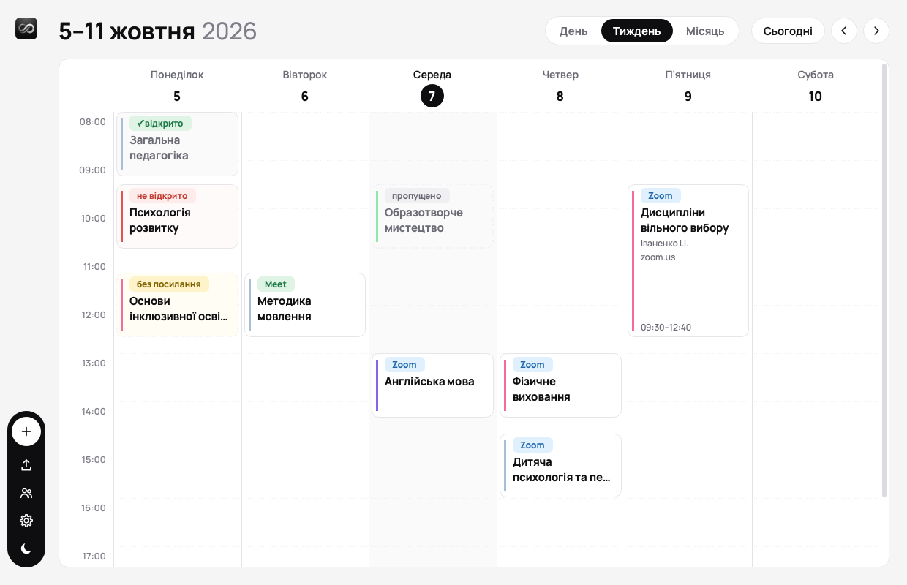

| Dark theme | Month |
| --- | --- |
| 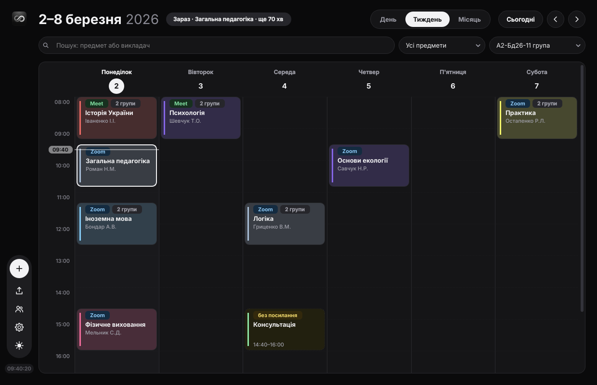 | 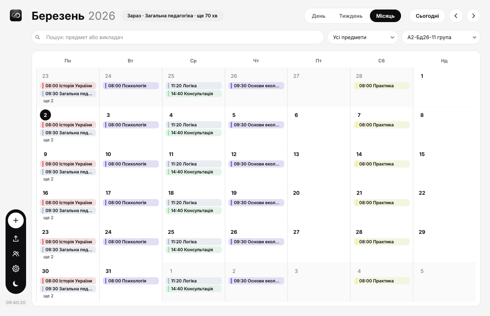 |

| A day | Changing a class | Settings |
| --- | --- | --- |
| 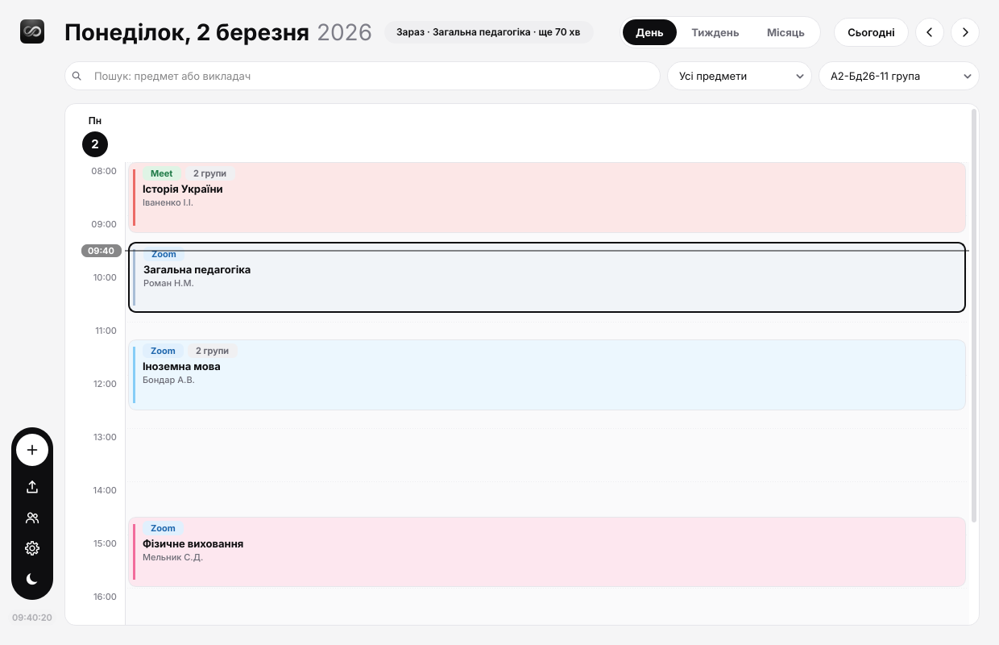 | 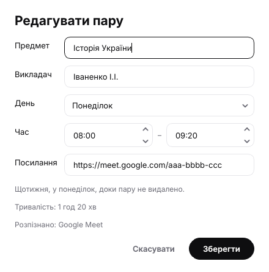 | 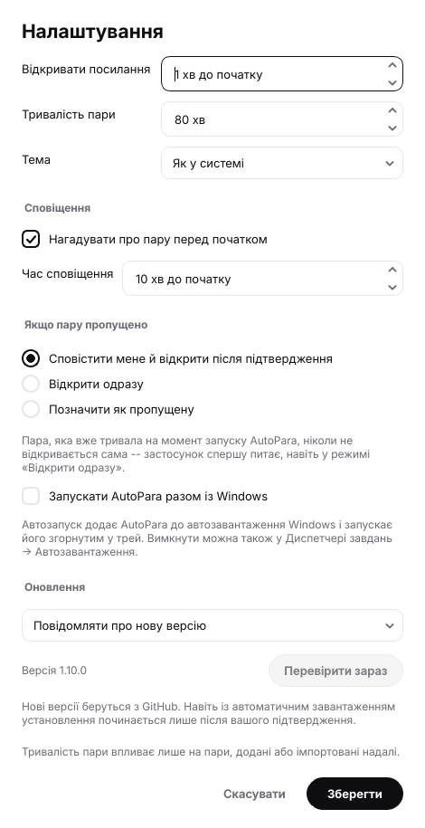 |

*The desktop pictures are rendered from an invented sample timetable, with the clock pinned to a
Monday morning; `cargo xtask screenshots` renders the same scenes from the 2.0 interface (compared in
[rust/PARITY_UI.md](rust/PARITY_UI.md)).*

### Android

The same timetable on a phone and a tablet, in Ukrainian (the default; Settings has a language
switch). The pictures are taken on emulators by the
[Android screenshots workflow](.github/workflows/android-screenshots.yml) from the same invented
timetable.

| Day | Week | Month | Editing a class |
| --- | --- | --- | --- |
| 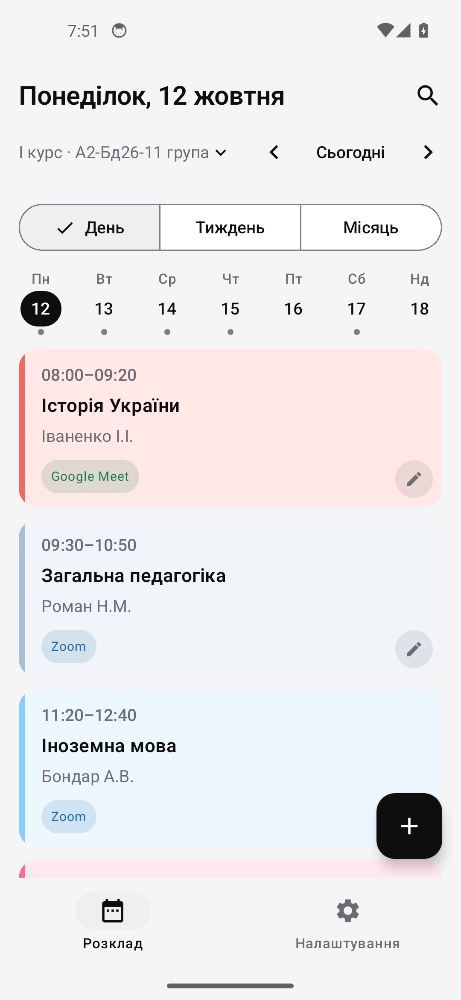 | 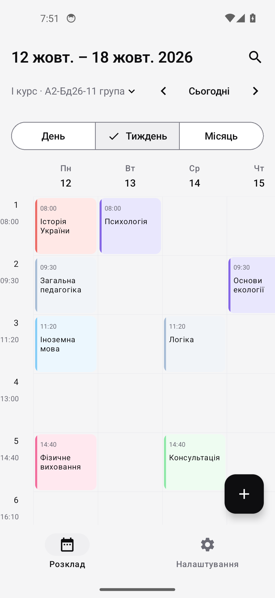 | 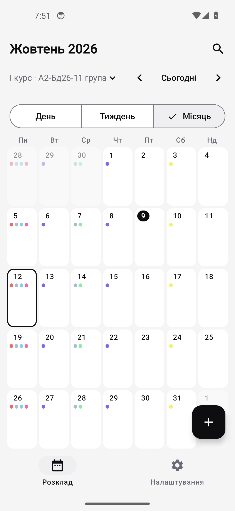 | 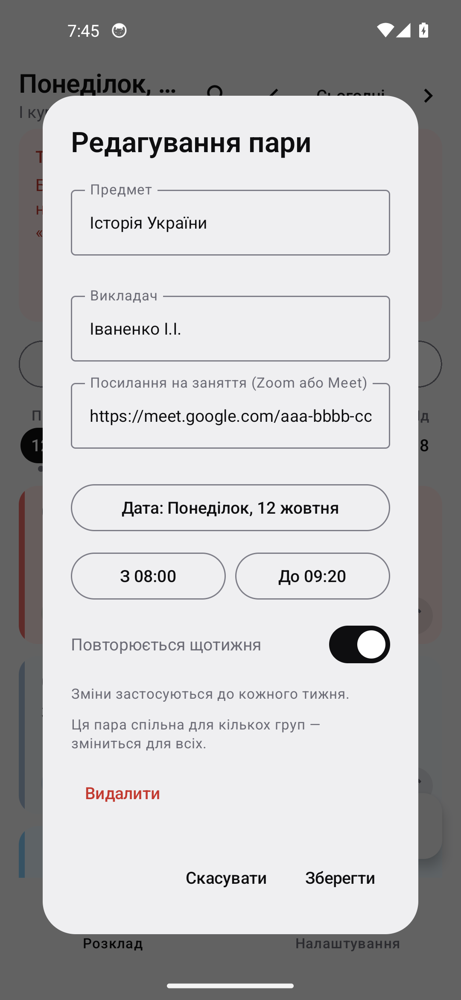 |

| Dark theme | Settings | The reminder, one minute before |
| --- | --- | --- |
| 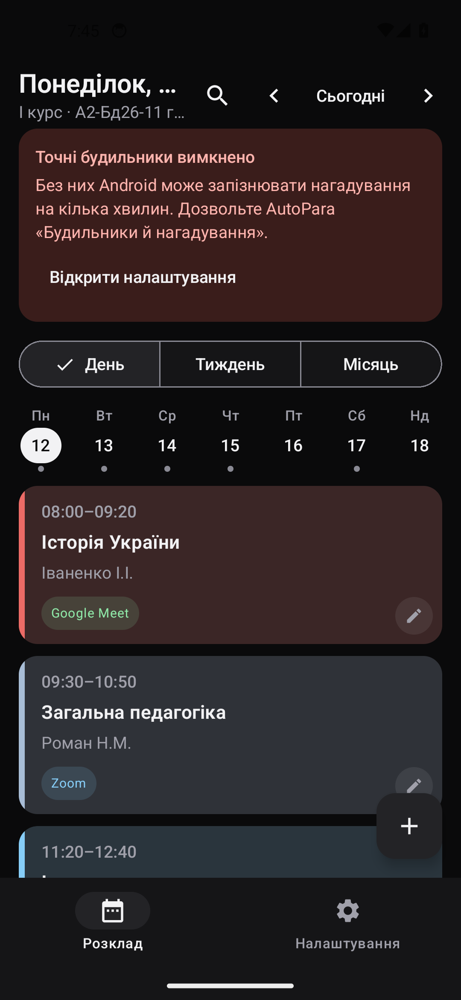 | 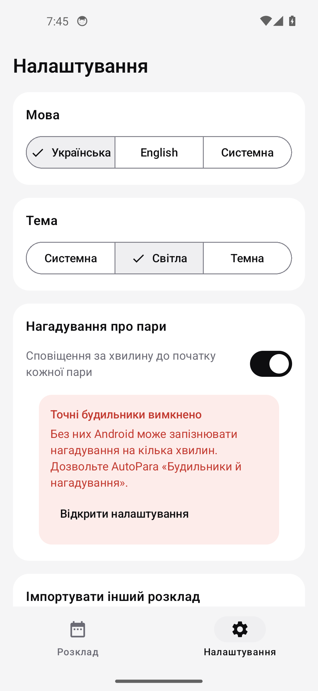 | 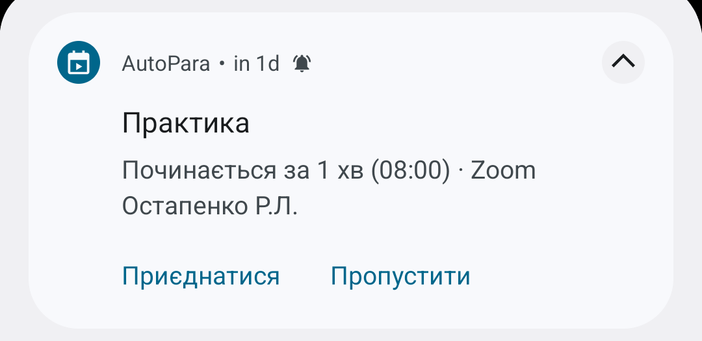 |

On a tablet the week grid has room for all seven days and a details pane sits beside it:

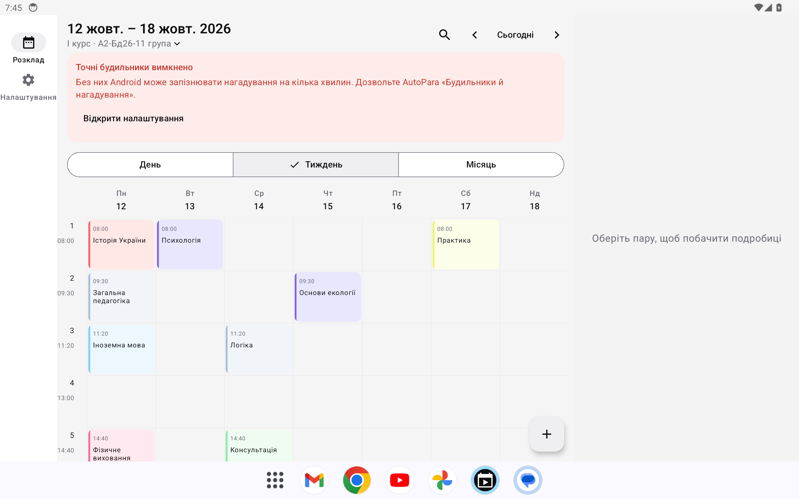

## Install

Download **`AutoPara-<version>-Setup.exe`** from the latest release and run it. That is the whole
procedure. On a Mac, take **`AutoPara-<version>.dmg`** (Apple Silicon) or
**`AutoPara-Intel-<version>.dmg`** (Intel) from the same release and drag AutoPara into
Applications; the app is not signed, so open it the first time through the context menu → Відкрити.
On Android, take **`AutoPara-<version>.apk`** from the same release (see
[android/README.md](android/README.md)); every download in a release has the same version number.

The target PC needs **nothing preinstalled**. Windows 10/11 64-bit; the app uses the system's
WebView2, which Windows 11 and an updated Windows 10 already have (the installer adds it otherwise).

It installs per-user to `%LOCALAPPDATA%\Programs\AutoPara`, so there are **no admin rights and no
UAC prompt**. You get Start Menu and (optionally) desktop shortcuts, an entry in Add or Remove
Programs, and an optional "start with Windows" component that launches it hidden in the tray.

Silent install and uninstall are supported with `/S`. Uninstalling asks whether to delete your
timetable and settings in `%APPDATA%\AutoPara`; No (and `/S`) keeps them, so reinstalling does not
lose the schedule.

**Coming from 1.x?** Run the 2.0 installer over it: it replaces the old program, and the first start
brings across your timetable, marks and settings. 1.x cannot download 2.0 by itself. Details in
[docs/UPGRADING.md](docs/UPGRADING.md).

## Run from source

The app is a Rust workspace in `rust/` with a Tauri 2 shell and a TypeScript interface. You need Rust
(stable, MSVC on Windows), Node.js LTS, and on Windows the Visual Studio C++ Build Tools, CMake and
libclang for the speech engine ([CONTRIBUTING.md](CONTRIBUTING.md) has the details).

```
cargo install tauri-cli --version "2.12.4" --locked   # once
cd rust/crates/autopara-app
npm ci
$env:AUTOPARA_DATA_DIR = "$env:TEMP\autopara-dev"  # keep a dev run away from your real data
cargo tauri dev
```

On first launch it opens on the import screen: **drag the `.docx` onto it** — anywhere on the
window, not just the dashed well — or press `Обрати файл…`. Then pick your course and group.

`npm run dev` and `http://localhost:5173/?demo` run the interface alone in a browser, on the sample
timetable with a pinned clock.

## Build it yourself

```
cd rust/crates/autopara-app
cargo tauri build --debug --no-bundle   # just the executable
cargo tauri build                       # the installer (or .app and .dmg on a Mac)
```

The installer lands in `rust/target/release/bundle/nsis/AutoPara_<version>_x64-setup.exe` (about
9 MB). A full build signs the update files and needs the updater key in `TAURI_SIGNING_PRIVATE_KEY`;
`--no-bundle` does not.

You do not have to build it to publish it: pushing to `main` builds Windows and both Macs on CI and
publishes the release ([`.github/workflows/rust-release.yml`](.github/workflows/rust-release.yml)),
but only when the version in `rust/Cargo.toml` has no release yet — so **bump that number in the
commit you want released.** See [docs/RELEASING.md](docs/RELEASING.md).

The Python 1.x app (`autopara/`, `build.cmd`, `installer/`) is still in the tree for reference and
its tests; it is no longer what gets released.

## How it behaves

- **Opens each class once.** The lead time defaults to 1 minute and is configurable. Restarting the
  app, waking from sleep, or changing the clock cannot cause a second open — the guarantee is a
  database constraint, not in-memory state.
- **A missed class is never opened behind your back.** If a class was already running when AutoPara
  started, the window comes forward with a banner naming it and two buttons — *Підключитися зараз*
  and *Закрити*. Nothing opens until you pick one. This holds even when the catch-up setting says
  "open immediately": that setting applies to a class that starts while the app is running.
- **Reminders.** An optional tray notification a configurable number of minutes before each class.
- **Any-language documents.** Day names are recognised in Ukrainian, Russian, English, Polish,
  German and several other languages; the schedule the app builds from them is always Ukrainian.
- **Editable straight away** — no edit mode. **Left click joins the class**, which is the one thing
  the app exists for, so it costs one click. **Right click opens the actions menu** (open, edit,
  mark as opened or skipped, delete). Click an empty slot to create a class there, drag a class to
  move it -- also in the month, onto another day. Moving a class that repeats asks whether to move
  **only that date** (the rest of the series stays) or the whole series. A class with no link offers
  to add one instead of opening.
- **Search and filters.** A search box finds a class by subject or teacher (Enter jumps to the next
  match, Shift+Enter to the previous one, Ctrl+F focuses the box), a drop-down shows only one
  subject, and another drop-down shows another group of the same course. The count says how much was
  found.
- **Day, week and month**, and a small pill beside the title that says what is on or next today.
  Moving between periods and views is a morph: a class on both sides of the change grows from its old
  shape into the new one, rather than the screen sliding. Each subject tints its cards, so a week can
  be read at a glance.
- **A real calendar day**, 08:00 to 18:00 in hourly rows, with each class drawn across the time it
  actually occupies rather than dropped into a slot — a 09:30 class starts halfway down the 09:00
  row. Columns are weekdays; the timetable repeats every week, so there are no dates and nothing to
  navigate. The whole day fits the window without scrolling.
- **A card is as tall as its class is long,** so a long subject cannot always be shown in full. The
  card is told its height and drops whole lines in a fixed order — the time goes first, since its
  position on the grid already says it — and its tooltip carries the subject, the teacher, the
  exact times, every group and the link.
- **Light and dark themes**, following the system theme until you pin one.
- **Shared classes.** One session taught to several groups is a single card tagged with the groups,
  and its link opens once.
- **Re-importing** a new document keeps the course and group you had selected and your manually
  added classes, and clears the old week's records — a new timetable starts on a clean grid. It
  also only applies from the moment you import it, so setting one up at the weekend does not mark
  that weekend as missed.
- **Your timetable is copied into the app**, so deleting the original `.docx` costs you nothing.
  Reinstalling keeps that copy; uninstalling asks whether to delete it.

Closing the window hides it to the tray; use the tray menu to quit.

## Lecture Assist

Off until you switch it on. During a class it transcribes the meeting's audio **on this computer**,
keeps live notes and flags questions in a small overlay on your own screen, and at the end writes a
summary. Audio is never saved, and nothing appears in the meeting. A chat model for the notes is
optional (your own key, kept in the system keychain). See [docs/ASSIST.md](docs/ASSIST.md).

## Third-party

The interface is set in **Inter** (Segoe UI on Windows), bundled under the SIL Open Font License
1.1. The app mark is one picture, which the tray, the rail, the first screen and the installer icons
are all made from. Every interface icon is drawn in code. Every Rust and npm dependency and its
licence is listed in [rust/THIRD_PARTY.md](rust/THIRD_PARTY.md); `cargo deny` keeps them permissive.

## Updates

AutoPara checks GitHub for a newer release shortly after it starts and every few hours, and tells
you (or, if you choose so in Settings, downloads it in the background). Every file is checked
against the release signing key. Installing is always your click: on Windows it runs the new
installer silently and restarts; on a Mac it replaces the app and restarts.

## Documentation

Read these before changing anything:

- [docs/ARCHITECTURE.md](docs/ARCHITECTURE.md) — stack, process model, data flow, scheduling, build.
- [docs/BACKEND.md](docs/BACKEND.md) — the `.docx` parsing rules, data model, scheduler, updates.
- [docs/FRONTEND.md](docs/FRONTEND.md) — screens, components, styling.
- [docs/ASSIST.md](docs/ASSIST.md) — Lecture Assist.
- [CONTRIBUTING.md](CONTRIBUTING.md) — commands, build environment and the invariants not to break.
- [docs/HANDOFF.md](docs/HANDOFF.md) — current state, known gaps and the traps already found.
- [docs/UPGRADING.md](docs/UPGRADING.md) — moving from 1.x to 2.0.
- [docs/RELEASING.md](docs/RELEASING.md) and [docs/RELEASE_CHECKLIST.md](docs/RELEASE_CHECKLIST.md)
  — how a version number becomes a published release.
- [rust/PORT_SPEC.md](rust/PORT_SPEC.md), [rust/DECISIONS.md](rust/DECISIONS.md) and
  [rust/PARITY_REPORT.md](rust/PARITY_REPORT.md) — the 1.x behaviour, every choice made in the
  rewrite, and how the two compare.

## Tests

```
cd rust
cargo xtask check
```

The whole gate: formatting, clippy, every Rust test, the TypeScript type check, lint and tests, and
the licence check. The parser and the scheduler are also held to the 1.10.0 app's own output
(`cargo xtask golden`, fixtures in `rust/fixtures/golden/`). Nothing needs the real timetable (it is
never committed: it holds live meeting links).
